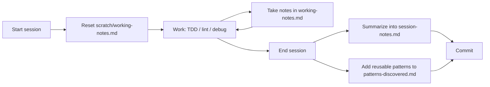

# Memory System

This directory is the project's **working memory**. It records the patterns, decisions and lessons found during development, so later sessions (human or AI) don't have to rediscover them.

---

## Purpose

AI assistants start every chat with no memory of earlier ones. Without a written record, the same bugs get rediscovered, the same decisions get debated again and the same patterns get reinvented. The memory system fixes this by:

- **Tracking patterns** that keep showing up in the codebase
- **Recording decisions** and why they were made
- **Keeping lessons** from TDD, linting and debugging sessions
- **Giving context** to Copilot so its suggestions match how this project already works

---

## Two Types of Memory

| Type | Location | Contents | Changes |
|------|----------|----------|---------|
| **Persistent memory** | [`.github/copilot-instructions.md`](../copilot-instructions.md) | Basic principles, workflows, testing approach, agent usage, git conventions | Rarely, and on purpose |
| **Working memory** | `.github/memory/` (this directory) | Discoveries, patterns, session history, active notes | Often, as work goes on |

**Rule of thumb:** If something is a *rule everyone must always follow*, it belongs in persistent memory. If it is *something we learned along the way*, it belongs in working memory. When a working-memory pattern becomes a firm convention, promote it to `copilot-instructions.md`.

---

## Directory Structure

```
.github/memory/
├── README.md                 # This guide (committed)
├── session-notes.md          # Summaries of completed sessions (committed)
├── patterns-discovered.md    # Accumulated code patterns (committed)
└── scratch/
    ├── .gitignore            # Ignores everything in scratch/
    └── working-notes.md      # Active session notes (NOT committed)
```

### `session-notes.md` - Historical record (committed)

- One summary per **completed** session
- Lists what was done, key findings, decisions and outcomes
- Kept short: a reader should understand a session in under a minute
- Committed to git so the team and future AI sessions can see the history

### `patterns-discovered.md` - Accumulated knowledge (committed)

- Reusable code patterns found while working
- Each entry follows a set template: name, context, problem, solution, example, related files
- Grows over time; update entries instead of duplicating them
- Committed to git

### `scratch/working-notes.md` - Active session (not committed)

- Your notepad for the **current** session
- Messy, quick notes are fine: hypotheses, failed attempts, open questions
- Ignored by git (see `scratch/.gitignore`) so half-formed notes never reach the repo
- Cleared or reset when a new session starts

### Key difference: `session-notes.md` vs `scratch/working-notes.md`

| | `scratch/working-notes.md` | `session-notes.md` |
|---|---|---|
| **When** | During the session | At the end of the session |
| **Style** | Raw, detailed, changing | Curated, short, final |
| **Committed?** | No | Yes |
| **Audience** | You and the AI, right now | Future you, teammates, future AI sessions |

Working notes are kept only for the session. Session notes are the curated summary you keep.

---

## Session Lifecycle



1. **Start:** Open `scratch/working-notes.md` and fill in *Current Task* and *Approach*.
2. **During:** Record findings, decisions and blockers as they happen.
3. **End:** Turn the important parts into a new entry in `session-notes.md`. Move any reusable pattern into `patterns-discovered.md`.
4. **Commit:** `git add .github/memory && git commit -m "docs: update memory with <session> findings"`

---

## When to Use Each File by Workflow

### TDD workflow (Red-Green-Refactor)

| Moment | Action | File |
|--------|--------|------|
| Test fails (RED) | Note what the test expects and your guess at the cause | `scratch/working-notes.md` → *Key Findings* |
| Choosing an implementation | Record the choice and the alternatives you rejected | `scratch/working-notes.md` → *Decisions Made* |
| Test passes (GREEN) | Note anything surprising | `scratch/working-notes.md` → *Notes* |
| Same fix needed again | Document it as a pattern | `patterns-discovered.md` |
| Session done | Summarize which tests were fixed and how | `session-notes.md` |

### Linting workflow

| Moment | Action | File |
|--------|--------|------|
| Running `npm run lint` | List error categories and counts | `scratch/working-notes.md` → *Current Task* |
| Fixing a category | Record the fix approach (e.g., remove vs. use unused vars) | `scratch/working-notes.md` → *Decisions Made* |
| Rule causes confusion | Document how this project resolves it | `patterns-discovered.md` |
| Lint clean | Summarize the categories fixed | `session-notes.md` |

### Debugging workflow

| Moment | Action | File |
|--------|--------|------|
| Reproducing the bug | Record the steps and the symptom | `scratch/working-notes.md` → *Current Task* |
| Forming hypotheses | List them and mark each confirmed or ruled out | `scratch/working-notes.md` → *Key Findings* |
| Stuck | Record what is blocking you | `scratch/working-notes.md` → *Blockers* |
| Root cause found | If the bug type could happen again, record it | `patterns-discovered.md` |
| Fixed and verified | Summarize the root cause and the fix | `session-notes.md` |

---

## How AI Uses These Files

Copilot reads persistent memory automatically. [`copilot-instructions.md`](../copilot-instructions.md) points to this directory, so the AI knows to check working memory when it needs context.

When working on a task, the AI should:

1. **Check `patterns-discovered.md`** before writing code. If a matching pattern exists (e.g., "initialize collections as empty arrays"), use it instead of making up a new approach.
2. **Read `session-notes.md`** to learn about earlier decisions. This avoids reopening settled questions or reintroducing bugs that were already fixed.
3. **Update `scratch/working-notes.md`** during long or multi-step tasks to keep track of progress, findings and next steps.
4. **Suggest new entries** for `patterns-discovered.md` when it sees a recurring fix.
5. **Summarize into `session-notes.md`** when asked to end or wrap up a session.

### Prompting tips

- *"Check `.github/memory/patterns-discovered.md` before implementing this endpoint."*
- *"Add what we just learned to my working notes."*
- *"Summarize `scratch/working-notes.md` into a new entry in `session-notes.md`."*
- *"Is this bug covered by an existing pattern? If not, document it."*

---

## Best Practices

- **Write it down right away.** Details are lost quickly.
- **Be specific.** "`todos` was `null`, so `.find()` threw" is more useful than "fixed a bug".
- **Link to files.** Use relative paths so readers can jump to the code.
- **Curate, don't hoard.** Session notes and patterns should be short and high-signal.
- **Update, don't duplicate.** Improve an existing pattern instead of adding a near-copy.
- **Promote stable conventions.** Move patterns that have become rules into `copilot-instructions.md`.
- **Never store secrets** (tokens, passwords, credentials) in any memory file.
